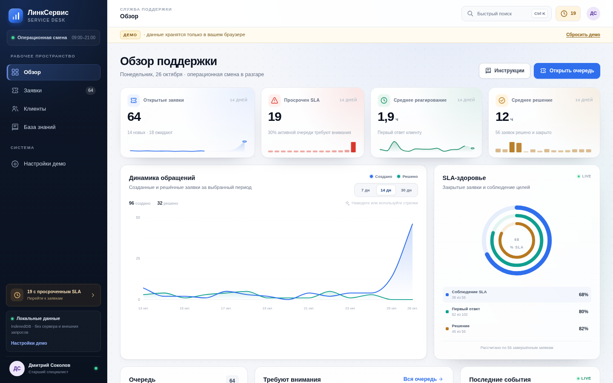
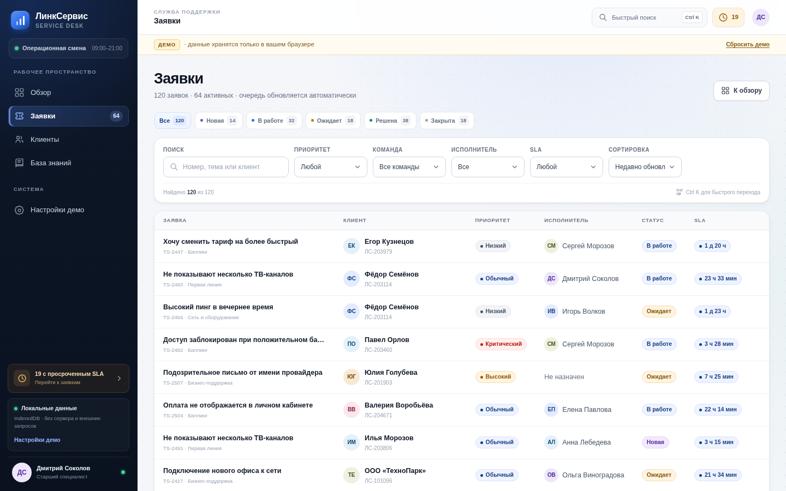
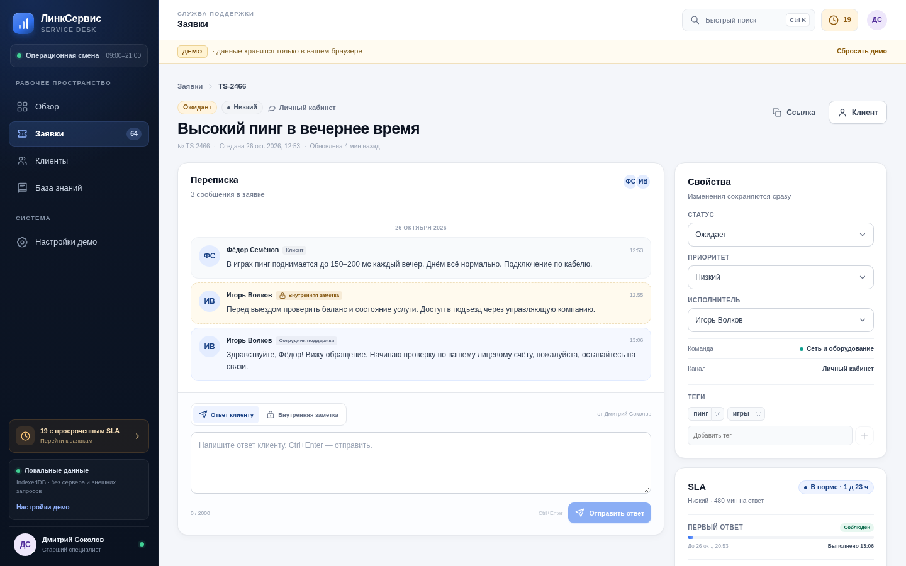
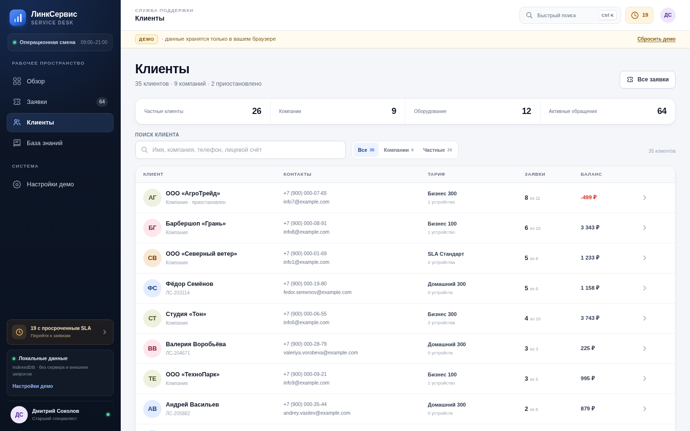
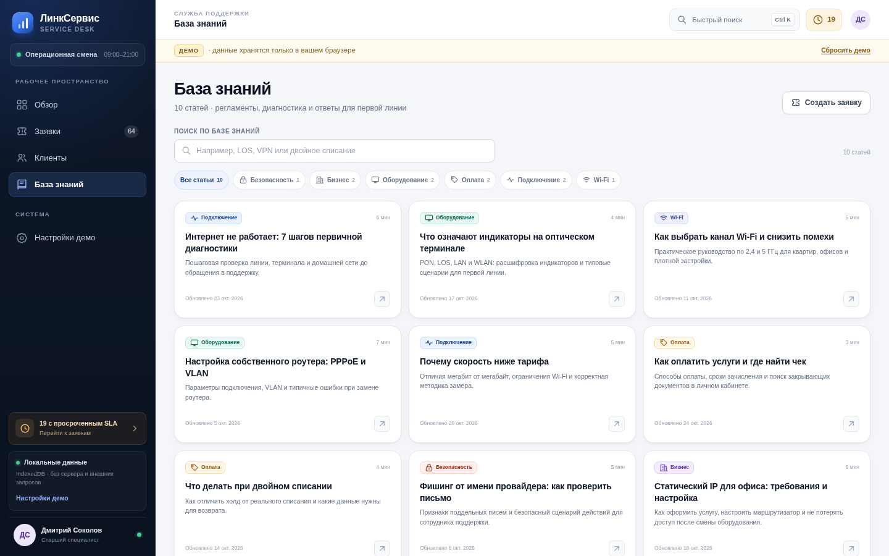
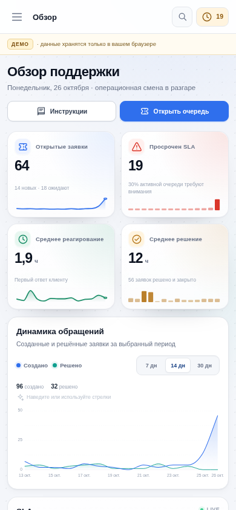

# ЛинкСервис — Tech Support CRM

A polished, client-only CRM demo for a fictional ISP support desk. It runs entirely in the browser: React, TypeScript, IndexedDB, deterministic demo data, Motion-powered interactions, custom SVG charts, and no backend.

The interface is in Russian; the codebase and project documentation are in English.



## Why this project

Most CRM demos need a server, an account, and a seeded cloud database. This one is intentionally the opposite: open the page and get a complete support workspace backed by local data. The goal was to demonstrate product thinking, realistic support workflows, careful information density, and frontend architecture without hiding behind a backend.

The core workflow is:

1. Triage an active queue by priority, status, team, assignee, and SLA.
2. Open a ticket, review the conversation, and add a customer reply or an internal note.
3. Change status, priority, assignee, and tags with immediate IndexedDB persistence.
4. Inspect the customer profile and linked equipment.
5. Find a procedure in the knowledge base or use `Ctrl/Cmd + K` to jump anywhere.
6. Reset the demo to its original deterministic state.

## Screens

| Dashboard | Tickets |
| --- | --- |
|  |  |

| Ticket detail | Clients |
| --- | --- |
|  |  |

| Knowledge base | Mobile dashboard |
| --- | --- |
|  |  |

## Features

- **Support dashboard** — bento KPI row with animated counters and sparklines, a custom 7/14/30-day created-vs-resolved SVG area chart with hover and keyboard inspection, animated SLA health rings, workload by priority/status, tickets requiring attention, and team activity.
- **Ticket workspace** — full-text search, combinable filters, sorting, status tabs, pagination, desktop table, and dedicated mobile cards.
- **Ticket detail** — customer/agent conversation, internal notes, reply composer, status/priority/assignee controls, tags, SLA targets, client summary, and linked equipment.
- **Customers** — search and segmentation, account and contact details, equipment inventory, ticket history, balance, and account notes.
- **Knowledge base** — category filtering, full-text search across article bodies, article reader, table of contents, and related articles.
- **Quick search** — native dialog palette for tickets, clients, articles, and navigation.
- **Keyboard shortcuts** — `Ctrl/Cmd + K` or `/` for search, `G` then `D/T/C/K/S` for navigation, `Esc` to dismiss overlays.
- **Local persistence** — every ticket change is written to IndexedDB and survives a reload.
- **Deterministic reset** — hold-to-reset interaction with a keyboard-accessible alternative recreates the original demo dataset.
- **Responsive UI** — designed for a 1440×900 desktop workspace and a 390×844 mobile viewport.
- **Accessible foundations** — semantic tables, labelled controls, native dialogs, focus management, skip link, visible focus states, and reduced-motion support throughout the Motion layer.

## Demo data

The first visit generates a relational dataset with:

| Entity | Count |
| --- | ---: |
| Tickets | 120 |
| Customers | 35 |
| Agents | 8 |
| Teams | 4 |
| Assets | 12 |
| Knowledge-base articles | 10 |

Tickets span five statuses, four priorities, four channels, multiple teams, tags, conversations, internal notes, and activity events. Around 56 tickets are completed and 64 are active, with a realistic share of SLA breaches.

SLA targets:

| Priority | First response | Resolution |
| --- | ---: | ---: |
| Critical | 30 min | 4 h |
| High | 1 h | 8 h |
| Normal | 4 h | 24 h |
| Low | 8 h | 48 h |

Data is generated relative to the browser's current time. Reset from **Настройки демо** or the demo banner.

> [!NOTE]
> All names, companies, phone numbers, addresses, and conversations are fictional. No analytics, external APIs, remote fonts, or third-party images are used.

## Architecture

```text
src/
  components/       Shared UI, layout, overlays, chart, activity feed
  domain/           Types, seed generator, SLA rules, selectors, repository
  lib/              Hash router, formatting, clock hook, ID generation
  pages/            Route-level screens
  state/            CRM and toast providers
  styles/           Design tokens, base, layout, components, pages, enhancements, responsive
```

Key decisions:

- **Domain-first structure.** SLA calculations, filtering, sorting, metrics, and seed generation are pure TypeScript and independently testable.
- **Runtime validation at boundaries.** Select values are narrowed with type guards instead of `any` or unsafe assertions.
- **IndexedDB as the persistence boundary.** The repository owns database setup, seed-on-first-run, snapshot reads, transactional ticket commits, and reset.
- **Deterministic PRNG.** A small seeded PRNG produces repeatable names, tickets, timelines, tags, and activity. There is no `Math.random()` in demo generation.
- **Hash routing.** Static hosting needs no server rewrites; deep links such as `#/tickets/ticket-0067` work anywhere.
- **Plain CSS with tokens.** The visual system uses a small set of design tokens and responsive breakpoints without a UI framework or CSS-in-JS runtime.
- **No network requests.** Fonts are system fonts, icons are inline SVG, and both the area chart and sparklines are hand-built with SVG and custom path math.
- **Motion with restraint.** Motion handles route/tab transitions, staggered entrances, counters, hover inspection, drawers, and dialogs while respecting `prefers-reduced-motion`.

The detailed decisions are recorded in [ADR 0001](docs/adr/0001-client-only-demo.md) and [ADR 0002](docs/adr/0002-indexeddb-demo-seed.md).

## Tech stack

- React 19
- TypeScript 6 in strict mode
- Vite 8
- IndexedDB via `idb`
- `motion` for accessible, reduced-motion-aware animation and transitions
- `date-fns` for dates and Russian localization
- Vitest for domain tests
- ESLint with TypeScript and React Hooks rules
- Plain CSS

## Run locally

Requirements: Node.js 20.19+ (CI uses Node 24) and npm.

```bash
npm ci
npm run dev
```

Production preview:

```bash
npm run build
npm run preview
```

The build is static and expects to be served from the domain root because `base` is `/`. Change `base` in `vite.config.ts` if deploying under a subpath.

## Quality checks

```bash
npm run typecheck
npm run lint
npm run test
npm run build
```

The test suite covers SLA calculations and formatting, seed counts/determinism/referential integrity, ticket filtering/sorting/metrics, knowledge-base search, daily created/resolved flow aggregation, and SLA health percentages.

GitHub Actions runs the same checks on pushes and pull requests using Node 24.

## Accessibility and UX notes

- Tables use `<caption>`, column headers, and readable mobile card alternatives.
- Filters are labelled; status tabs expose `aria-pressed`.
- The command palette uses a native `<dialog>` with a combobox/listbox pattern.
- The mobile drawer traps focus, restores focus on close, and locks background scrolling.
- All interactive elements have visible `:focus-visible` styles.
- Motion is reduced when `prefers-reduced-motion` is enabled; animated counters and transitions settle immediately.
- The chart exposes a hidden day-by-day table, keyboard arrow navigation, and an accessible summary.
- The reset control supports pointer hold and an immediate Enter/Space alternative.
- Empty, loading, storage-error, and not-found states are explicitly designed.

## Design references and credits

The dashboard borrows interaction and composition ideas from the following projects; all implementation in this repository is original and hand-built:

- **Bklit UI** — inspiration for the smooth area-chart presentation, gradient fill, and hover crosshair.
- **Motion** — animation engine used for page transitions, staggered content, counters, drawers, dialogs, and layout indicators.
- **Kokonut UI** — inspiration for the concentric progress rings and bento-style KPI composition.

No component code, themes, or assets from those projects are copied. The app uses no external fonts, images, CDNs, or runtime network requests.

## Limitations

This is a portfolio prototype, not a production service desk:

- No authentication, roles, or permissions.
- No attachments, email/telephony integrations, or real-time sync.
- Data is local to one browser profile and one device.
- Article feedback is presentational and not persisted.
- The dataset is intentionally small enough for client-side computation.

## License

MIT. See [LICENSE](LICENSE).
